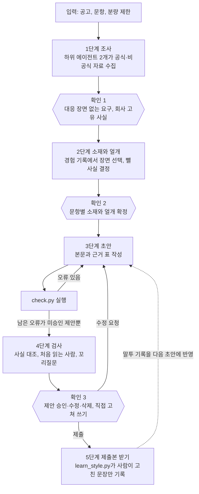
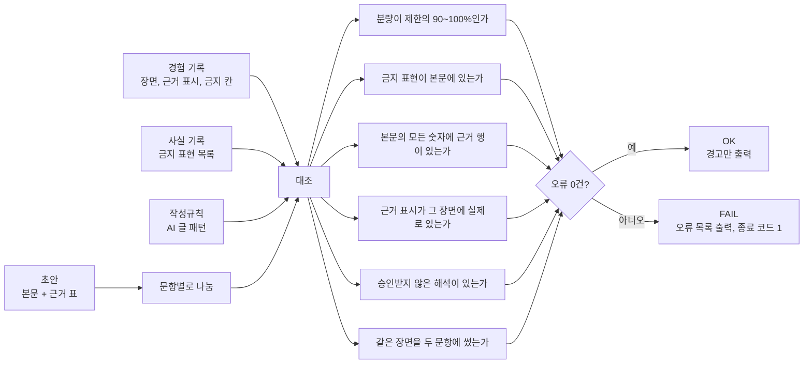

# jaso-checker

AI가 쓴 자기소개서 초안을 사실 기록과 대조해 검사하는 Claude Code 스킬과 검사 스크립트입니다.

초안의 모든 숫자와 사실 구절에 근거가 달려 있는지, 금지한 표현이 들어갔는지, 분량이 맞는지를 스크립트가 판정합니다. 판정에 정답이 있는 항목만 스크립트가 맡고, 나머지(소재 선택, 해석 승인)는 사람이 확인하는 지점에서 멈추게 했습니다.

## 왜 만들었나

AI에게 자소서 초안을 맡기면 문장은 매끄럽지만 없는 숫자와 부풀린 역할이 섞여 나옵니다. 읽어서 잡는 방식은 빠뜨리는 것이 많았습니다. 그래서 초안 형식을 고정하고, 본문에 나온 숫자와 사실이 경험 기록에 있는지를 코드로 확인하게 했습니다.

## 작동 흐름

### 전체 단계

다섯 단계로 진행하고, 사람이 확인해야 하는 세 곳에서 멈춥니다. 확인을 받기 전에는 다음 단계의 파일을 만들지 않습니다.



### check.py가 초안 하나를 판정하는 과정



## 구성

| 경로 | 내용 |
|---|---|
| `SKILL.md` | 스킬 본문. 조사, 소재와 얼개, 초안, 검사, 제출본 5단계와 사용자 확인 지점 3곳 |
| `references/` | 단계별 지침과 산출물 양식. 하위 에이전트 지시문 포함 |
| `scripts/check.py` | 초안 검사기 |
| `scripts/check_bank.py` | 경험 기록(뱅크) 형식 검사기 |
| `scripts/learn_style.py` | 초안과 제출본을 비교해 사람이 고친 문장만 말투 기록에 쌓음 |
| `scripts/tests/` | pytest 테스트 77개 |
| `examples/` | 지어낸 예시 자료. 통과하는 초안과 실패하는 초안 |

## check.py가 잡는 것

오류(통과를 막음)

- 분량 초과와 부족 (글자 또는 바이트, 공백 포함 여부, 한글 2·3바이트)
- 금지 표현 (사실 기록의 금지 목록, 인용한 장면의 금지 칸, 작성규칙의 AI 글 패턴)
- 근거 행이 없는 숫자. 단위까지 비교하므로 `30개 중 7개` 행이 `팀 7명`의 7을 덮지 않음
- 본문에 없는 사실 구절, 없는 장면 ID, 장면에 없는 근거 표시, 출처를 알 수 없는 근거
- 사용자가 승인하지 않은 해석(`제안`)
- 같은 장면을 두 문항에 사용
- 참고 자료의 인용 문장과 12자 이상 겹침

경고(통과를 막지 않음)

- 수치 개수, 날짜 개수, 같은 어미 3연속, 같은 시작어, 문장 길이 균일, 접속어 과다, 문항 간 첫 어절과 끝 어절 겹침, 말투 기록의 안 쓰는 표현

잡지 못하는 것: 근거가 달린 사실을 과장해 쓴 문장, 글의 설득력. 이 둘은 4단계의 사실 대조와 처음 읽는 사람 검사(하위 에이전트), 그리고 사용자 확인에 맡겼습니다.

## 실행

Python 3.10 이상, 검사 스크립트는 표준 라이브러리만 씁니다. 테스트에는 pytest가 필요합니다.

```
python3 scripts/check_bank.py examples/bank
python3 scripts/check.py examples/draft_pass.md --bank examples/bank --ledger examples/ledger.md --rules examples/rules.md
python3 scripts/check.py examples/draft_fail.md --bank examples/bank --ledger examples/ledger.md --rules examples/rules.md
cd scripts && python3 -m pytest -q
```

`draft_fail.md`는 금지 표현 4건, 근거 없는 숫자 2건, 미승인 제안 1건으로 실패합니다. 테스트는 76개 통과, 1개 건너뜀입니다. 건너뛰는 1개는 이 저장소에 넣지 않은 참고 카드 파일의 존재를 확인하는 테스트입니다.

## 만든 방식

코드는 Claude Code로 작성했습니다. 제가 한 일은 검사 항목을 정하고, 테스트 결과를 확인하고, 실제 지원서에 써 보며 규칙을 고친 것입니다.

- 설계 문서와 구현 계획을 먼저 쓰고, 기능을 테스트와 함께 추가했습니다.
- 실제 지원서 한 건으로 시험 운행을 했습니다. 두 판의 초안을 어느 쪽인지 가린 채 문항별로 비교해 골랐고, 그 결과로 규칙을 고쳤습니다(첫 문장은 문항에 바로 답한다, 날짜는 문항당 1개 이하 등). 날짜 경고는 이때 추가했습니다.
- 써 보면서 검사기가 놓친 경우를 테스트로 고정했습니다. 영문 단위가 붙은 숫자(`10ms`), 단위가 다른 같은 숫자, 빈 근거 칸, 모르는 유형 값이 그 예입니다.

## 공개 범위

원래 저장소에는 개인 경험 기록과 지원서가 함께 있어, 도구 부분만 옮겼습니다. 테스트와 예시의 이름, 숫자, 문장은 모두 지어낸 것으로 바꿨습니다. 참고 카드(합격 자소서 구조 분석)는 넣지 않았습니다.
